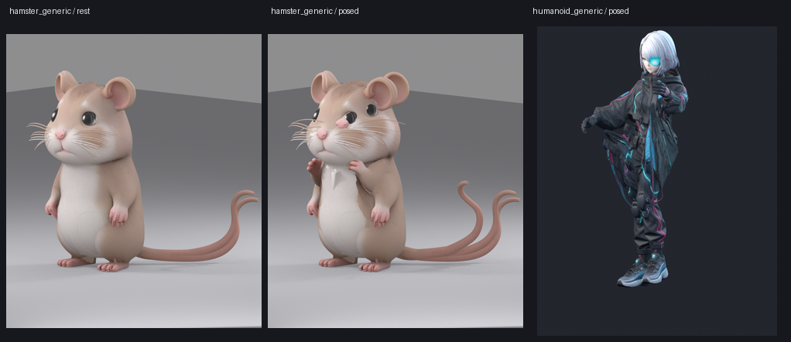

# blender-character-pipeline

> 给 AI 助手用的 Blender 角色流水线：**三视图（或单张图）→ 模型 → 骨架 → 动画**，每个阶段强制停下来让人确认。

一套在 Blender 里用 Python 做完整角色资产的**可复用方法论 + 工具脚本**。不是教程，是踩完坑之后的成品流程——每一条结论都有实测数据支撑。

**不预设体型**：标准人形、Q 版、四足动物、贴地的胖仓鼠，都是先量体型再生成骨架。没有一行按头身比写死的参数。



## 为什么需要它

用代码在 Blender 里做角色动画，绝大多数人（包括 AI）会掉进同样的坑：

**坑一：用几何体拼人。** 圆柱当胳膊、球当脑袋。做出来永远是"积木人"，调多少参数都救不回来。

**坑二：直接用骨骼热权重。** AI 生成的网格有几千个分离壳体，热权重会全部返回 0 权重——它需要水密流形。

**坑三：动画靠手调数值。** 关键帧数字看着对，动起来抽搐、顺拐、脚飘。因为真正的原因是**插值方法、坐标系、相位定义**，不是参数。

**坑四：把"标准人形"的骨架参数套到别的体型上。** 0.28m 的仓鼠按 1.68m 的比例套，腿已经伸直到 99.4%，一步都迈不出去。

## 三阶段流程

```
角色图 ──▶ 阶段一 建模 ──▶ ⛔ 确认 ──▶ 阶段二 骨架 ──▶ ⛔ 确认 ──▶ 阶段三 动画 ──▶ 交付
```

| 阶段 | 产物 | 卡点 |
|---|---|---|
| 一、建模 | `.blend` + 四视图渲染 | 像不像？确认才继续 |
| 二、骨架 | `_rig.blend` + 静止/姿势对照图 | 摆姿势会不会撕裂？ |
| 三、动画 | `_anim.blend` + `.glb` + GIF + 指标表 | 动作自不自然？ |

**每个阶段必须停下来让用户看，确认后才能进下一阶段。** 一次性跑完三段再给结果，等于让人在错误的模型上雕刻。

## 通用化：怎么做到"任意体型"

```python
m    = measure.measure(mesh_obj)                    # 量体型
arch, why = measure.guess_archetype(m)             # humanoid / biped_small / quadruped
spec = archetypes.build_spec(m, arch)              # 按实测比例生成骨骼清单
rig  = rig_build.build_armature(spec)              # 建骨架（零约束纯 FK）
rig_build.attach_mesh(mesh_obj, rig)               # 烘焙变换 + 挂 Armature
weights.auto_weights(mesh_obj, rig, spec)          # 包络权重
feas = measure.feasibility(m, spec)               # 能不能迈步 → 决定动画方案
```

四个决定性的判断：

| 判断 | 信号 | 反面教材 |
|---|---|---|
| 正方朝向 | **脚掌接触块**相对髋部偏前（脚一定朝前伸） | 用头部重心判 → 长发/耳朵把它带反，整副骨架落到背后 |
| 人形 vs 矮胖 | 裆高：横截面**分成左右两簇**的最高高度 | 从下往上找中线顶点 → 挂饰命中，裆高测成 0 |
| 两足 vs 四足 | 接触块的**前后跨度** > 25%H | 数接触块数量 → 正常人也能测出 4 块 |
| 能否迈步 | `leg_extend` / `horiz_margin` / `belly_clearance` | 直接按"步幅 0.5m"设计 → 触地脚悬空 21.5mm |

**两个验证案例**（同一套 API，没有按体型写死的参数）：

| | 仓鼠（直立，贴地） | 赛博朋克少女 |
|---|---|---|
| 身高 / 顶点 | 0.280 m / 149,978 | 1.680 m / 188,019 |
| 拓扑 | 单壳体 | 2,456 壳体 |
| 分类 | `biped_small`（裆高 0%H） | `humanoid`（裆高 55%H） |
| 骨骼 | 28 骨 / 27 变形 | 23 骨 / 22 变形 |
| 蒙皮 | 0 漏权，全骨生效 | 0 漏权，22 骨全生效 |
| 可行性 | 腿已伸至 99.4%、腹离地 1mm → **原地踏步** | 宽松 → 可迈步 |

## 核心经验（摘自踩坑记录）

### 建模

用图生 3D（混元 / Tripo / Meshy）出底模，再在 Blender 里修材质、对齐。手搓代码建模的天花板是"能看出是这个角色"。

必须做的一步：**图生 3D 导出的 GLB 里 metallic/roughness 是打包贴图**，Blender 解释后金属度接近 1，渲染成铬金属人。断开贴图 link，改 `metallic=0`、`roughness=0.62`。

### 绑骨

- **别用 Rigify**：metarig 是 T-pose，与 A-pose 模型不符；且算子在这个上下文里拿不到 active_object
- **别直接算热权重**：2456 个壳体的 AI 网格会全部返回 0；代理体也是越细越失败（细体素保留了伪毛发薄片），0.008 在 1.68m 上是甜点
- **默认用包络权重**：只看顶点到骨骼线段的距离，与拓扑无关。实测 0 漏权、全骨生效
- **必须先烘焙网格变换**：AI 模型常带 1.44 倍缩放 + −90° 旋转，不烘焙就整体错位、模型缩水到 1/7

### 动画

五个根因覆盖 90% 的问题：

| 根因 | 症状 | 修法 |
|---|---|---|
| action 已挂载时摆姿势 | 数值对不上、首帧错乱 | 构建期间 `action=None`，先记录后写帧 |
| 分段余弦插值 | 动作一顿一顿 | 换单调三次 Hermite（C1 连续） |
| 坐标系用错 | 人歪着走、双臂挤胸前 | 扭转写 Y 轴不写 Z；摆臂用世界方向 |
| 相位形状不匹配 | 顺拐 | `arm_wave(q) = -cos(2π(q - stance))` |
| IK 无 pole / 进奇异区 | 膝盖肘部单帧翻 40-160° | 解析两骨 IK + `dmin=0.185` |

**几组实测数据**：

- 换插值后，跑步摆动相的脚速从 `6 → 36 → 24 → 51 → 60 → 23 → 52 → 84`（锯齿）变成 `10 → 24 → 38 → 41 → 45 → 49 → 56 → 59`（平滑钟形）
- 修顺拐后，`corr(同侧腿,臂)` 从 −0.530 变成 **−0.965**，`corr(对侧)` 从 +0.479 变成 **+0.979**
- Attack 的力量感来自**速度对比**不是角度：蓄力 14mm/帧 → 爆发 153mm/帧 → 命中骤停 7mm/帧（10.7 倍）

## 目录

```
SKILL.md                     入口：三阶段流程 + 确认卡点 + 验收指标
references/
  00-generic-pipeline.md     通用化：测量、体型分类、包络权重、上下文兜底
  01-modeling.md             图生 3D、材质修复、尺寸对齐
  02-rigging.md              骨架结构、代理体热权重、权重整形、壳体收尾
  03-animation.md            相位设计、解析 IK、C1 插值、贴地、爆发曲线
  troubleshooting.md         症状 → 根因 速查表
scripts/
  measure.py                 体型测量 / 体型分类 / 可行性预检
  archetypes.py              骨骼模板与 spec 生成
  rig_build.py               建骨架、烘焙变换、挂 Armature
  envelope.py                包络权重（默认蒙皮）
  weights.py                 热权重 / 代理体 / 解析权重 / 校验
  grounding.py               脚部落点、世界方向瞄准、贴地
  gait.py                    正负号标定、步态规划、写 Action
  ctx.py                     bpy.ops 上下文兜底
  gspline.py                 C1 连续单调三次插值
  blender_bridge.py          socket 桥接（不需要 MCP 工具注册）
  boot_blender.py            无 UI 自动拉起 Blender + 启动服务
  pipeline_common.py         骨骼工具：aim / 解析 IK / 记录写帧 / 贴地
  verify.py                  动画验收指标
  bcommon.py                 建模辅助（放样、管体、材质）
```

## 用法

**前提**：Blender 装了 `mcp-for-blender` 插件（addon 名 `blender_mcp`）。

```bash
# 1. Blender 没开时自动拉起
blender.exe --python scripts/boot_blender.py

# 2. 确认连通
python scripts/blender_bridge.py scene

# 3. 执行任意 bpy 脚本（脚本落盘再执行，别用命令行传大段代码）
python scripts/blender_bridge.py run my_step.py
```

在 Blender 内用管线：

```python
import sys
sys.path.insert(0, r"<repo>/scripts")
import measure, archetypes, rig_build, weights, envelope, grounding, gait, ctx

m = measure.measure(mesh_obj)
print(measure.report(m, *measure.guess_archetype(m)))
```

## 已知限制

这套流程做不到的（提前知道比事后返工好）：

- **包络权重对复杂分层服装会拉伸**：连帽衫的帽/下摆与袖子是同一张连续面，转臂时会被拉成"帘子"。这类资产建议 `method="heat"` 或手工补权重
- **腿已伸直的模型做不出真实步幅**，只能原地踏步；要真迈步得改模型（腿加长 / 腹部抬高）
- **重叠薄片会导致"重影"**：AI 网格常带位置重合的重复面片，摆姿势时各自飞到不同位置（几何问题，权重只能缓解）
- 没有手指骨，握拳做不出来
- 没有表情骨（脸是贴图）
- 极限姿势下肩/肘/胯仍有轻微挤压（无 corrective shape key）
- 程序化动画仍缺真人动捕的不规则性

## License

MIT
